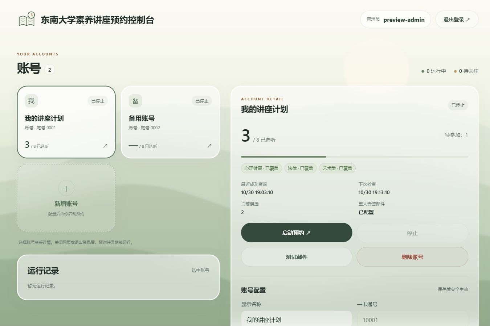

# SEU Literacy Lecture Reservation Console

[中文](README.md)

A multi-account lecture reservation tool with a Chinese console and the existing CLI. The console uses plain HTTP with administrator username/password login and must run only on a trusted LAN or VPN. Administrators share full access to the same school accounts. Each account independently authenticates, reserves, verifies results and tracks attendance progress. Requests to the university still use certificate-validated HTTPS.

The goal remains **8 attended humanities and scientific literacy lectures, including law, art and mental health**. Enabled salons can be reserved but do not count. Test activities and ticket notices are excluded. The university makes the final assessment.

Polling uses random intervals by phase: wait 4–6 seconds after each ordinary scan; target activity-list request starts 0.05–0.10 seconds apart from five seconds before opening until nine seconds after it. Other periods within the opening window (30 seconds before to five minutes after) use 0.5–1.5 seconds. Ordinary polling resumes afterwards, or earlier once no targets remain and no submission is pending. Ordinary history is cached for at most 30 seconds and rechecked when a submittable candidate appears. Opening intervals include request time; random timing does not guarantee avoiding automation detection. See the [polling guide](docs/usage.md#开抢与拥塞恢复).

Ordinary polling may reflect manual cancellations, attendance changes and new reservations about 30 seconds later, plus a scan and request time. Check the reservation snapshot timestamp for freshness. Update the code and restart the CLI process or management service to activate this policy.



The screenshot uses offline synthetic accounts and state, not live school records.

## Install

Production deployment targets Linux with Python 3.12 and uv. Windows supports the CLI and offline checks.

```bash
git clone https://github.com/MuZiJin701/seu-lecture-reserve-http.git
cd seu-lecture-reserve-http
uv sync --locked
cp -n .env.example .env
```

Keep an existing configuration and add the Web fields from [.env.example](.env.example). The program loads `.env` from the working directory; do not source it. Process environment variables take precedence.

## Configure and start the console

Enter administrator usernames and passwords directly in `.env`; no hash command is required. An empty or invalid mapping prevents startup. Multiple administrators have equal permissions; additions, removals and password changes take effect after restarting the console. Replace the example passwords below:

```dotenv
SEU_WEB_HOST=0.0.0.0
SEU_WEB_PORT=8080
SEU_DATA_DIR=state
SEU_WEB_ADMINS='{"admin":"REPLACE_WITH_YOUR_PASSWORD","other":"ANOTHER_PASSWORD"}'
```

Existing password hashes remain supported; `uv run --locked seu-reserve-web --hash-password` is optional. Plain passwords are hashed in memory at startup without rewriting the configuration. The `.env` file still contains plaintext passwords; never commit or share it.

Use `--config /absolute/path/.env` to select another configuration file. `SEU_WEB_HOST=0.0.0.0` only binds every interface; it is **not a browsable address**. Open `http://127.0.0.1:8080` locally, or the server's real IP from another machine. Deploy only on a trusted LAN or VPN. HTTP does not encrypt passwords or sessions; never expose the port publicly. Sessions expire after a fixed 12 hours and after a console restart. Logging out does not stop reservations. No TLS certificate is required.

```bash
uv run --locked seu-reserve-web
```

Open `http://127.0.0.1:8080` (or the server address). Log in, add an account using the last card, select it to edit configuration and inspect progress and current reservations, then explicitly start it. Stale edits are rejected without discarding the input. Send SMS and enter its code in that account's authentication panel; other accounts continue. Closing the page does not stop reservations.

Saving a running console account safely stops and restarts its worker. A CLI already holding that account's state lock blocks the save. If the CLI takes the lock after the save completes, the save succeeds, the page shows that the CLI is running, and the CLI uses the saved configuration.

See the [Web console, systemd and risk notes](docs/web.md) (Chinese). A new deployment starts from an empty data root and does not detect or import old single-account task files.

## Mail and account data

Keep the shared SMTP sender in the server `.env`, using `SMTP_USERNAME` and `SMTP_PASSWORD`. Set one recipient per school account in the console. An empty recipient disables its mail; the sender is never a fallback recipient. Enabling mail with invalid shared configuration blocks that account's startup. Delivery failure does not change reservation results. A nonempty recipient automatically enables major alerts and every reservation success notice; the console can send a test email.

As explicitly chosen, school passwords and cookies are stored **locally in plaintext**, used only on the server, and never returned to the page. Keep `.env` and the data directory outside version control. Because storage is plaintext and file permissions are not restricted, anyone who can access the data directory can read the credentials. Stop an account before deletion; unresolved submissions or interval holds must be checked first. Deleting local data does not cancel school reservations.

Each school account has its own process, and the console allows only one worker per account. The identity lock has been removed, so one school account may use concurrent sessions (single account, single machine, roughly 4 minutes of read-only evidence; see the [concurrent login record](docs/acceptance/2026-10-30-concurrent-login.md)); avoid extra diagnostic logins during the opening period. Ten accounts is an acceptance target, not a hard cap; actual capacity depends on the machine. Two task sets in different data roots cannot discover or coordinate with each other. For routine reservations, keep one active task set per school account and coordinate it yourself to avoid duplicate traffic.

## Existing CLI

```bash
# Managed accounts use their unified state. The selector accepts a card number or internal ID.
uv run --locked main.py --account YOUR_CARD_NUMBER --status
uv run --locked main.py --account YOUR_CARD_NUMBER --check
uv run --locked main.py --account YOUR_CARD_NUMBER
```

Managed accounts always enable device trust, prewarm, CAPTCHA prefetch, background history refresh, opening alignment and success notifications, with no title filter. These controls are hidden. The current reservation list reuses engine queries, shows its synchronization time, and separates unresolved submissions and interval holds.

The old single-account `.env` mode and its configuration choices without `--account` are retained: `uv run --locked main.py` still works. Use `--account` for managed accounts. See the [CLI usage guide](docs/usage.md) (Chinese).

## Validation boundaries

Offline evidence for this redesign is in the [console redesign acceptance](docs/acceptance/2026-10-30-console-redesign.md). Existing single-account live reservations are recorded for [2026-10-26](docs/acceptance/2026-10-26-live-run.md), [2026-10-28](docs/acceptance/2026-10-28-live-run.md) and [2026-10-29](docs/acceptance/2026-10-29-live-run.md). Evidence for the HTTP console simplification and concurrent sessions is in the [current HTTP simplification record](docs/acceptance/2026-10-30-http-console.md) and the [concurrent login record](docs/acceptance/2026-10-30-concurrent-login.md); the earlier HTTPS-version offline evidence is kept in the [2026-10-30 Web offline acceptance](docs/acceptance/2026-10-30-web-offline.md). Real multi-account operation and long runs still require separate acceptance; the [2026-11-01 live run on a Volcengine Ubuntu server](docs/acceptance/2026-11-01-live-run.md) records one single-account online opening with submission, confirmation and window metrics.

The [2026-10-31 review fixes and follow-up](docs/acceptance/2026-10-31-review-fixes.md) cover running-account saves, actual request body limits, concurrent login limits and CLI configuration consistency. The full offline suite passed **711 tests, with 3 platform skips**; mypy passed. The same day's [lock, alert and pending-evidence fixes](docs/acceptance/2026-10-31-lock-and-pending-fixes.md) cover non-blocking alert mail, per-account directory isolation, dropped start intent on an interrupted save, stop intent written under the checkpoint lock, connect-timeout retry accounting and the `FBZT='-1'` success-evidence policy. The full offline suite passed **719 tests, with 3 platform skips**; mypy passed. The [opening fast path and diagnostics](docs/acceptance/2026-11-01-opening-fast-path.md) remove the main-loop blocking wait during an opening, add a half-second fallback and alignment/headcount diagnostics, and fix the recycled-reader bypass, `last_error_active` misreporting and a false alignment record on stop; a follow-up also removes the opening history wait, stops a missing history reader from bypassing the three-miss guard, stops withdrawn `FBZT='-1'` records from occupying time conflicts, unifies the hold time base with the host/school clock, alerts the CLI on explicit credential rejection, and fixes the persisted alert key so corrected credentials can restart normally. A further two-axis review pass aligns the rebuild interval to 0.1 s, removes an unreachable legacy wait branch, deduplicates the missing-snapshot diagnostics per outage, extends the history three-miss guard to a running-but-unusable reader, stops fabricating a network error when a pending check has no fresh snapshot, and tightens holds even while pending. The [2026-11-03 startup-cleanup and bounded-DNS record](docs/acceptance/2026-11-03-startup-cleanup-and-bounded-dns.md) moves failed-startup cleanup under the checkpoint lock so only the checkpoint this process created is removed (covering the pre-lock and post-unlock interleavings), and adds bounded DNS resolution in the connection layer (background resolution, deadline wait, 60 s cache and resolver cap; a resolver that finishes after the request timed out still warms the cache for the next request) so opening fallback budgets also cover DNS. The full offline suite passed **737 tests, with 3 platform skips**; mypy passed. The same day's [review-fix record](docs/acceptance/2026-11-03-review-fixes.md) adds a pending fast-path request throttle with one event per pending episode, restores the documented prewarm budget, releases a leaked DNS resolver slot, and serializes local log appends; the suite then passed **740 tests, with 3 platform skips**.

The [2026-11-03 random polling acceptance](docs/acceptance/2026-11-03-random-polling.md) records the earlier version: **748 offline tests passed, with 3 platform skips**, and mypy passed. Short read-only samples against the real university server succeeded **36/36 and 7/7** in the two scheduling phases; an isolated ordinary engine run stopped normally after about 25 seconds. This schedule has not been deployed or validated during a real opening.

The latest [query-reduction acceptance](docs/acceptance/2026-11-03-query-reduction.md) covers the five-second-before to nine-second-after burst, early return to ordinary polling when no targets remain, a 30-second ordinary history cache, and a fresh history check before submitting cached candidates. **754 offline tests passed, with 3 skips**; mypy passed. Real read-only samples succeeded **38/38 and 5/5**, and an isolated ordinary engine queried history once in about 25 seconds. This change has not been deployed or tested in a real opening.

Existing 429/`Retry-After`, short backoff and fallback handling is retained. The earlier claim that the school actively throttles requests was an unsupported assumption and has been withdrawn. [Existing measurements](docs/acceptance/2026-10-29-read-only-probe.md) observed no business-API throttling; that assumption must not explain failures or set polling rates. Single-account samples do not establish multi-account capacity.

Maintainer: [MuZiJin701](https://github.com/MuZiJin701) · [Requirements](docs/requirements.md) · [Glossary](GLOSSARY.md) · [Historical promotional assets](docs/promo/usage.md)
