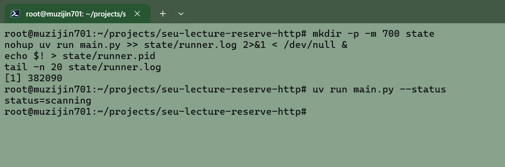

# 东南大学讲座预约 · HTTPS 版

[English](README.en.md)

面向 Linux 服务器的讲座预约工具，兼容 Windows。无需浏览器，配置账号和筛选条件后，持续查找讲座、识别验证码并尝试预约。

默认以学校记录中的已打卡 8 场、法律／艺术／心理健康各至少 1 场为目标。预约一场后继续；已有预约覆盖缺口时暂停新增，等实际打卡达标后结束。沙龙不预约、不计数。

已有记录时间重叠时，自动选择互不冲突的场次计数，只调整本地统计，不取消学校预约；最终有效场次以学校认定为准。选择顺序见[使用指南](docs/usage.md#运行和恢复)。

## 使用截图

Linux 服务器后台启动与本地任务状态查询：



`status=scanning` 表示本地任务处于扫描状态，不代表进程健康或预约成功。后台进程和日志的核对方法见[使用指南](docs/usage.md#服务器后台运行)；真实预约及长期运行仍待验收。

联合宣传海报：[高清 PNG](docs/promo/seu-lecture-poster.png) · [Python 生成说明](docs/promo/usage.md)，同时介绍 Windows 浏览器版与 Linux HTTPS 版。

## 快速开始

先准备 Python 3.12 和 [uv](https://docs.astral.sh/uv/getting-started/installation/)。

**1. 下载并安装依赖**

```bash
git clone https://github.com/MuZiJin701/seu-lecture-reserve-http.git
cd seu-lecture-reserve-http
uv sync --locked
```

**2. 填写配置**

首次使用时复制样例；已有 `.env` 时保留原文件。

```bash
cp -n .env.example .env
chmod 600 .env
```

用文本编辑器打开 `.env`，填写账号、密码及需要的线下校区：

```dotenv
SEU_CARD_NUMBER="你的一卡通号"
SEU_PASSWORD='你的密码'
SEU_PREFERRED_CAMPUS='["无锡校区"]'
```

校区名称须与学校系统一致，请按需修改。默认校区列表为空，只预约线上讲座。其他配置可以先保留样例值。程序自动读取当前目录的 `.env`，不用执行 `source`；进程环境变量优先。

**3. 检查登录和查询**

```bash
uv run main.py --check
```

显示 `event=read_only_complete` 表示登录、当前查询数据和验证码图片检查通过，不代表已验证真实预约。列表非空时也校验讲座字段；列表为空时无法验证其字段。这一步不提交预约、不发邮件；需要短信认证时按终端提示处理。失败时查看 `event=task_failed` 所在行，对照[排错说明](docs/usage.md#先做只读检查)。

**4. 开始预约**

```bash
uv run main.py
```

此命令会提交真实预约。没有合适讲座时安静等待，默认每 10 秒查询。前台运行时保持 SSH 终端开启；按 `Ctrl+C` 停止，再次执行原命令会继续原任务，不会取消已有预约。

## 在服务器后台运行

确认没有其他实例后，在项目目录执行：

```bash
mkdir -p -m 700 state
nohup uv run main.py >> state/runner.log 2>&1 < /dev/null &
echo $! > state/runner.pid
tail -n 20 state/runner.log
```

SSH 断开后仍可运行，但进程退出或服务器重启后不会自动启动。后台遇到需要人工认证的情况会退出并保留任务；确认后台已退出后，执行 `uv run main.py` 在前台处理。修改过 `SEU_STATE_DIR` 时，请同步修改上面的日志路径。进程核对及恢复方法见[服务器后台运行](docs/usage.md#服务器后台运行)。

## 查看任务状态

在项目目录查看本地任务记录，不会启动新的预约进程：

```bash
uv run main.py --status
```

| 状态 | 含义 |
| --- | --- |
| `not_started` | 尚无本地任务 |
| `scanning` | 任务尚未完成，仍需扫描或核对进度 |
| `pending` | 预约提交结果待确认 |
| `done` | 已打卡目标完成 |

输出首行仍为 `status=...`，后面增加运行信息：

| 字段 | 怎么看 |
| --- | --- |
| `process_running` | 是否有进程持有本任务的锁；`false` 表示没有正在运行的预约实例 |
| `phase` | `authentication` 为登录中，`waiting` 为扫描后等待，`waiting_for_attendance` 为等待打卡，`backoff` 为异常退避，`manual_required` 为需人工处理 |
| `last_query_at` / `last_query_age_seconds` | 最近成功查询时间及距今秒数；`never` / `unknown` 表示尚无成功记录 |
| `updated_at` / `snapshot_age_seconds` | 运行状态最后更新时间及距今秒数；长时间不更新时结合阶段和 `next_check_at` 排查 |
| `failure_count` / `last_error` / `last_error_at` | 连续失败次数、最近错误及发生时间；恢复后次数清零，旧错误保留供排查 |
| `activity_count` / `candidate_count` | 最近一次讲座列表条数及通过筛选的候选数；`unknown` 表示该轮未查询列表 |
| `mail_status` | `disabled` 未配置、`ready` 已配置、`sending` 发送中、`accepted` 服务器接受、`failed` 发送失败；不代表收件箱送达 |

判断是否在正常工作，结合 `process_running=true`、最近的成功查询时间及当前阶段。候选数为 0 且成功查询时间持续更新，表示本轮没有可选候选；可能尚未开放预约或不满足筛选条件，不代表预约提交已经验证。正常轮询不刷屏。`phase=unknown` 表示旧任务尚无新运行信息或信息无效，不能当作健康证明。

**`scanning` 本身不代表程序还在运行。** 使用上述后台启动方式时，也可检查 PID 文件对应的进程：

```bash
ps -p "$(cat state/runner.pid)" -o pid,ppid,args
```

没有对应进程行，说明该 PID 已退出；即使进程存在，也不能据此确认最近一次查询成功。查看最近输出和事件：

```bash
tail -n 20 state/runner.log
tail -n 20 state/events.log
```

日志可能保留旧错误，请结合时间判断；尚无日志时可能提示文件不存在。修改过 `SEU_STATE_DIR` 时，请调整这里和下方命令的路径。

## 停止与继续

前台运行时，在原终端按 `Ctrl+C`。后台运行时，先读取 PID 并核对命令和工作目录：

```bash
reserve_pid=$(cat state/runner.pid)
ps -p "$reserve_pid" -o pid,ppid,args
readlink "/proc/$reserve_pid/cwd"
```

确认命令是 `uv run main.py`、工作目录是本项目后，再执行：

```bash
kill -TERM "$reserve_pid"
```

`uv` 会把停止信号转发给 Python 子进程。再次执行上面的 `ps` 命令核对退出；`No such process` 表示该 PID 已结束。PID 文件可能过期，不要跳过核对。

停止不会取消学校已有预约。保留 `state` 目录，再执行 `uv run main.py` 或上述后台启动命令即可继续原任务。已完成目标需要重新核对时使用 `uv run main.py --new-task`，升级前已完成的任务也需用此命令按重叠选择的新口径核对。

## 常用配置

修改 `.env` 后重新启动生效。列表使用 JSON 数组，例如 `'["无锡校区"]'`。

| 配置 | 用途 |
| --- | --- |
| `SEU_PREFERRED_CAMPUS` | 允许的线下校区，`'[]'` 表示不约线下 |
| `SEU_ENABLE_ONLINE` / `SEU_ENABLE_OFFLINE` | 是否允许线上／线下，填 `true` 或 `false` |
| `SEU_PREFERRED_LECTURES` | 只匹配完整标题，`'[]'` 表示不限标题 |
| `SEU_REQUIRED_CATEGORIES` | 候选类别及顺序，通常保留样例中的四类 |
| `SEU_VPN_IP` | 首次登录的备用网关 IP；始终先尝试正常 DNS，留空关闭回退 |

指定标题仍须满足其他筛选条件和时间冲突检查。备用 IP 样例为 `121.249.14.2`，仅在网关解析失败、连接关闭／重置或 TLS 意外断开后回退一次；普通超时和证书错误不触发。回退后沿用至进程结束，下次启动重新尝试 DNS。完整边界及 IP 更新方法见[网关 DNS 回退](docs/usage.md#仅在项目内绕过网关-dns-故障)。

邮件通知可选。不配置也能运行；使用 Gmail 时只需补充：

```dotenv
SMTP_USERNAME=your-address@gmail.com
SMTP_PASSWORD='your-app-password'
```

默认自己给自己发邮件，使用应用专用密码。配置方法、其他邮箱及关闭通知的步骤见[使用指南](docs/usage.md#gmail-示例)。

验证邮件配置，可以单独发送一封测试邮件，不登录学校、不启动预约任务：

```bash
uv run main.py --test-mail
```

显示 `event=test_mail_accepted` 表示 SMTP 服务器已接受，再去收件箱核对。正常运行时，预约成功、目标完成、需要人工处理和可捕获的异常退出会尝试发信；连续三轮查询或处理失败提醒一次，恢复后重新计数。单次错误和正常等待不发邮件，发信失败记录 `notification_failed`，不自动重发。强制杀进程、断电或邮件服务不可达时，不能保证收到通知。

## 使用提醒

- 已核对非空真实讲座列表：按预约时间窗和发布状态筛选，线上线下仅识别标题开头明确的 `【线上】`／`【线下】` 标记；未知字段会报错。名额和资格仍以学校预约前检查为准，服务器时钟须准确。详情见[接口边界](docs/usage.md#当前业务数据契约与限制)。
- 真实登录、只读查询及测试邮件送达已验证；真实预约、短信恢复及修复后的长期运行仍待验收。请在 [SEU 门户](https://ehall.seu.edu.cn/)核对预约与打卡结果，统计不代替学院最终认定。
- `.env` 包含凭据，请勿上传；预约结果不明时程序先查询原活动，不盲目重复提交。
- 开发检查、详细配置及验收记录见[使用文档](docs/usage.md)。

维护者：[MuZiJin701](https://github.com/MuZiJin701) · [项目地址](https://github.com/MuZiJin701/seu-lecture-reserve-http) · [浏览器版本](https://github.com/MuZiJin701/SEU_Lecture_Reserve)
