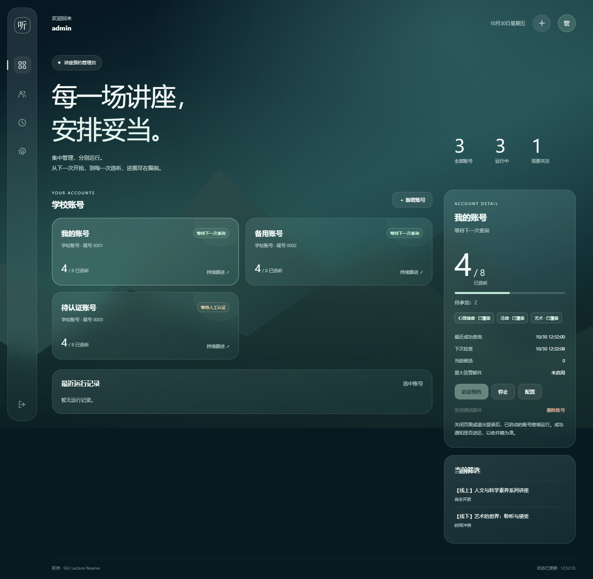

# 东南大学讲座预约 · HTTP 管理台

[English](README.en.md)

支持多学校账号的讲座预约工具，提供中文管理台和原有 CLI。管理台使用明文 HTTP、没有管理员登录，只部署在可信局域网或 VPN，由本人或少数可信操作者集中配置账号；每个学校账号独立运行、认证、核对预约结果和统计选听进度。访问学校系统的请求仍使用通过证书校验的 HTTPS。

目标仍为实际选听 **8 场人文与科学素养系列讲座，法律、艺术、心理健康各至少 1 场**。沙龙可按配置预约但不计入目标；测试活动与购票公告不预约。最终认定以学校为准。



截图使用构造账号与状态，不是真实学校运行记录。

## 安装

生产部署使用 Linux、Python 3.12 和 uv；Windows 可运行 CLI 和离线检查。已有工具可直接使用。

```bash
git clone https://github.com/MuZiJin701/seu-lecture-reserve-http.git
cd seu-lecture-reserve-http
uv sync --locked
cp -n .env.example .env
```

已有配置保留原文件，按 [.env.example](.env.example) 补充 Web 字段。程序自动读取当前目录 `.env`，不要 `source .env`；进程环境变量优先。

## 配置并启动管理台

管理台默认使用以下配置，不需要管理员密码或 TLS 证书：

```dotenv
SEU_WEB_HOST=0.0.0.0
SEU_WEB_PORT=8080
SEU_DATA_DIR=state
```

可用 `--config /绝对路径/.env` 指定其他配置文件。管理台没有管理员登录，只应部署在可信局域网或 VPN；同网段任何可达机器都能操作管理台并接触明文保存的学校凭据，不要把端口暴露到公网。

```bash
uv run --locked seu-reserve-web
```

打开 `http://127.0.0.1:8080`（服务器部署换成实际地址）。添加学校账号、设置筛选和收信邮箱，保存后手动点击“启动预约”。需要短信时，在对应账号卡片里发送短信并输入验证码；其他账号继续运行。关闭网页不会停止后台任务。

[完整 Web 使用、systemd 部署与风险说明](docs/web.md)。新部署从空数据根目录开始，不检测也不导入旧的单账号任务文件。

## 邮件与账号数据

SMTP 发信账号仍在服务器 `.env` 中配置，例如 `SMTP_USERNAME`、`SMTP_PASSWORD`；每学校账号在网页指定一个收信邮箱。留空关闭该账号邮件，绝不默认发给公共发信邮箱。启用邮件而公共配置无效时阻止该账号启动；发送失败不改变预约结果。只发重大告警及可选成功通知，可在网页发送测试邮件。

学校密码和 Cookie 按已确认方案**本地明文保存**，仅服务器使用，网页不回显密码；数据目录与 `.env` 不进入仓库。明文保存且不限制文件权限，能访问数据目录的人即可取得凭据。删除账号前先停止，存在待确认或时间占位时先核对；删除本地数据不会取消学校已有预约。

每学校账号使用独立进程，Web 内同账号只允许一个工作进程。账号身份锁已移除，同一学校账号允许并发登录（单账号单机约 4 分钟只读实测，见[并发登录记录](docs/acceptance/2026-10-30-concurrent-login.md)）；开抢期仍建议避免额外的诊断登录。10 账号仅为验收目标，不设硬上限；实际容量取决于设备。不同数据根目录的两套任务无法互相发现，也不能互相协调。

## 保留的 CLI

```bash
# 已纳管账号使用其统一状态；账号参数可为一卡通号或内部 ID。
uv run --locked main.py --account 你的一卡通号 --status
uv run --locked main.py --account 你的一卡通号 --check
uv run --locked main.py --account 你的一卡通号
```

不带 `--account` 的旧单账号 `.env` 运行方式仍保留，可用 `uv run --locked main.py` 启动。已纳管账号使用 `--account`。入口、恢复和诊断字段见[CLI 使用指南](docs/usage.md)。

## 验证边界

已有单账号真实预约记录见 [2026-10-26](docs/acceptance/2026-10-26-live-run.md)、[2026-10-28](docs/acceptance/2026-10-28-live-run.md)及 [2026-10-29](docs/acceptance/2026-10-29-live-run.md)。管理台 HTTP 简化与同账号并发登录的证据见[本轮 HTTP 简化验收](docs/acceptance/2026-10-30-http-console.md)与[并发登录记录](docs/acceptance/2026-10-30-concurrent-login.md)；HTTPS 版本的离线记录保留在[2026-10-30 Web 离线验收](docs/acceptance/2026-10-30-web-offline.md)。真实多账号、Linux systemd 和长期运行仍需分别验收。

保留现有 429／`Retry-After`、短退避与故障回退逻辑。此前“学校会主动限流”的判断属于无实测支持的主观猜测，已撤回；[既有实测](docs/acceptance/2026-10-29-read-only-probe.md)未观察到业务接口限流，不以该猜测解释故障或选择请求频率。多账号负载不能由单账号样本推定。

维护者：[MuZiJin701](https://github.com/MuZiJin701) · [需求](docs/requirements.md) · [术语](GLOSSARY.md) · [历史宣传素材](docs/promo/usage.md)
