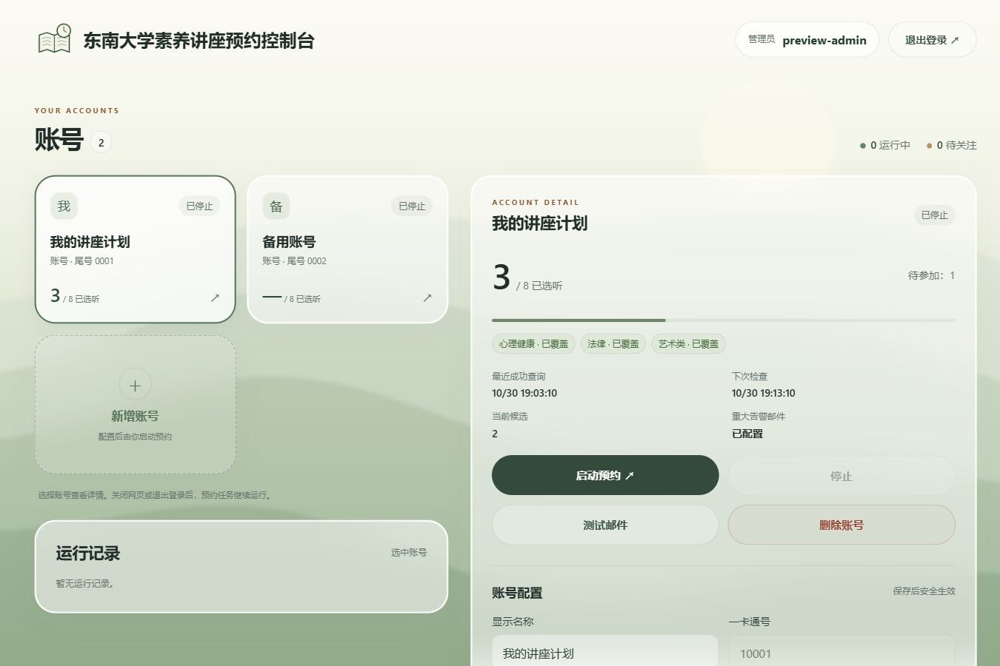

# 东南大学素养讲座预约控制台

[各时期线程协作与预约查询策略（图表）](docs/thread-query-strategy.md)

[English](README.en.md)

支持多学校账号的讲座预约工具，提供中文管理台和原有 CLI。管理台使用明文 HTTP、需要管理员账号和密码登录，只部署在可信局域网或 VPN；多个管理员共同管理同一套学校账号；每个学校账号独立运行、认证、核对预约结果和统计选听进度。访问学校系统的请求仍使用通过证书校验的 HTTPS。

目标仍为实际选听 **8 场人文与科学素养系列讲座，法律、艺术、心理健康各至少 1 场**。沙龙可按配置预约但不计入目标；测试活动与购票公告不预约。最终认定以学校为准。

所有阶段保留主线程、活动列表只读线程、历史列表只读线程和可选邮件线程，预约验证码预取、现场及判错重取统一使用一个按需工作线程。列表目标请求开始间隔：普通期随机 4–6 秒；预约开放前 5 秒至后 9 秒随机 0.05–0.10 秒；其余开抢时段（前 30 秒至后 5 分钟）随机 0.5–1.5 秒。历史普通期约每 25 秒刷新、快照有效期 30 秒，开抢期约每 5 秒刷新、有效期 10 秒；普通期出现可提交候选时请求历史线程重新核对。目标间隔包含请求耗时；没有待抢目标且无待确认提交时提前降频，线程继续运行。随机化不保证避免自动化识别。详见[查询策略](docs/usage.md#开抢与拥塞恢复)。

普通期手动取消、考勤与新增预约可能延后约 30 秒加一轮扫描及请求耗时反映；以预约清单同步时间判断新鲜度。新策略须更新代码并重启原 CLI 或管理服务才生效。



截图使用构造账号与状态，不是真实学校运行记录。

两条只读线程自行查询与重试，普通期请求预算 10 秒、开抢期 2 秒；主线程采用版本通知及绝对等待截止时间，消费快照、认证、派发验证码任务和串行提交，不再同步兜底查询。验证码线程归还主会话后才能认证或提交，提交前用已有可靠快照复核候选及冲突，空闲不取图；任务状态仍只由主线程同步写入，邮件独立排队发送。私有日志复用安全文件句柄，服务器磁盘实测未触发增加写线程的条件。当前实现、离线与真实只读检查见[统一验证码线程验收](docs/acceptance/2026-11-04-captcha-worker.md)与此前 [P0/P1/P2 验收](docs/acceptance/2026-11-04-event-preparation.md)；真实开抢仍待验收，生产服务未更新。历史结果见[统一线程验收](docs/acceptance/2026-11-03-unified-workers.md)与[19:00 实战记录](docs/acceptance/2026-11-03-opening-recovery.md)。

快抢、慢抢列表快照均允许保留成功响应后两秒，明确查询失败仍暂停新增；见[调整验收](docs/acceptance/2026-11-04-opening-snapshot-2s.md)。

## 安装

生产部署使用 Linux、Python 3.12 和 uv；Windows 可运行 CLI 和离线检查。已有工具可直接使用。

```bash
git clone https://github.com/MuZiJin701/seu-lecture-reserve-http.git
cd seu-lecture-reserve-http
uv sync --locked
cp -n .env.example .env
```

已有配置保留原文件，按 [.env.example](.env.example) 补充 Web 字段。程序自动读取当前目录 `.env`，不要 `source .env`；进程环境变量优先。

## 配置并启动管理台

直接在 `.env` 的管理员列表填写账号和密码，无需生成哈希。没有有效管理员时服务拒绝启动；可添加多个同等权限管理员，增删或改密后重启管理服务生效。配置示例（替换示例密码）：

```dotenv
SEU_WEB_HOST=0.0.0.0
SEU_WEB_PORT=8080
SEU_DATA_DIR=state
SEU_WEB_ADMINS='{"admin":"换成你的密码","other":"另一个密码"}'
```

已有密码哈希仍兼容，`uv run --locked seu-reserve-web --hash-password` 仅为可选工具。直接填写的密码在启动时派生为内存中的哈希，不改写配置；`.env` 仍含明文密码，不要提交或分享。

可用 `--config /绝对路径/.env` 指定其他配置文件。`SEU_WEB_HOST=0.0.0.0` 只是让服务监听所有网卡，**不是浏览器访问地址**；本机请打开 `http://127.0.0.1:8080`，其他机器用服务器实际 IP。管理台仍使用 HTTP，不需要 TLS 证书，只应部署在可信局域网或 VPN；登录信息和会话没有传输加密，不要把端口暴露到公网。管理员会话固定有效 12 小时，退出不停止预约，服务重启后需要重新登录。

```bash
uv run --locked seu-reserve-web
```

打开 `http://127.0.0.1:8080`（服务器部署换成实际地址）。登录后，在卡片队列末尾新增学校账号；选中卡片，在详情区修改配置、查看进度与当前预约，保存后手动点击“启动预约”。多人编辑发生冲突时拒绝覆盖并保留输入。需要短信时，在对应账号卡片里发送短信并输入验证码；其他账号继续运行。关闭网页不会停止后台任务。

运行中的管理台账号保存配置时会安全停止并重启。若外部 CLI 已持有该账号状态锁，保存会被拒绝；若 CLI 在保存完成后抢先取得锁，保存仍成功，页面显示“CLI 正在运行”，CLI 使用保存后的配置。

[完整 Web 使用、systemd 部署与风险说明](docs/web.md)。新部署从空数据根目录开始，不检测也不导入旧的单账号任务文件。

## 邮件与账号数据

SMTP 发信账号仍在服务器 `.env` 中配置，例如 `SMTP_USERNAME`、`SMTP_PASSWORD`；每学校账号在网页指定一个收信邮箱。留空关闭该账号邮件，绝不默认发给公共发信邮箱。启用邮件而公共配置无效时阻止该账号启动；发送失败不改变预约结果。填写邮箱后自动发送重大告警及每次成功通知，可在网页发送测试邮件。

学校密码和 Cookie 按已确认方案**本地明文保存**，仅服务器使用，网页不回显密码；数据目录与 `.env` 不进入仓库。明文保存且不限制文件权限，能访问数据目录的人即可取得凭据。删除账号前先停止，存在待确认或时间占位时先核对；删除本地数据不会取消学校已有预约。

每学校账号使用独立进程，Web 内同账号只允许一个工作进程。账号身份锁已移除，同一学校账号允许并发登录（单账号单机约 4 分钟只读实测，见[并发登录记录](docs/acceptance/2026-10-30-concurrent-login.md)）；开抢期仍建议避免额外的诊断登录。10 账号仅为验收目标，不设硬上限；实际容量取决于设备。不同数据根目录的两套任务无法互相发现，也不能互相协调。日常预约建议同一学校账号只保留一套实际运行任务，由操作者协调，避免重复流量。

## 保留的 CLI

```bash
# 已纳管账号使用其统一状态；账号参数可为一卡通号或内部 ID。
uv run --locked main.py --account 你的一卡通号 --status
uv run --locked main.py --account 你的一卡通号 --check
uv run --locked main.py --account 你的一卡通号
```

已纳管账号统一开启设备信任、预热、验证码预取、后台历史刷新、开抢对齐和成功通知，不再按标题过滤；网页隐藏这些选项。当前预约清单复用引擎已有查询，显示最近同步时间，待确认和时间占位单独列出。

不带 `--account` 的旧单账号 `.env` 运行方式和原配置能力仍保留，可用 `uv run --locked main.py` 启动。已纳管账号使用 `--account`。入口、恢复和诊断字段见[CLI 使用指南](docs/usage.md)。

## 验证边界

本轮管理员登录与单页改版的离线证据见[改版验收](docs/acceptance/2026-10-30-console-redesign.md)。已有单账号真实预约记录见 [2026-10-26](docs/acceptance/2026-10-26-live-run.md)、[2026-10-28](docs/acceptance/2026-10-28-live-run.md)及 [2026-10-29](docs/acceptance/2026-10-29-live-run.md)。管理台 HTTP 简化与同账号并发登录的证据见[本轮 HTTP 简化验收](docs/acceptance/2026-10-30-http-console.md)与[并发登录记录](docs/acceptance/2026-10-30-concurrent-login.md)；HTTPS 版本的离线记录保留在[2026-10-30 Web 离线验收](docs/acceptance/2026-10-30-web-offline.md)。真实多账号与长期运行仍需分别验收；2026-11-01 的[火山引擎服务器真实开抢记录](docs/acceptance/2026-11-01-live-run.md)已在 Ubuntu 24.04 + systemd 上取得一次单账号线上开抢的提交、确认与窗口指标。

2026-10-31 的[审查修复与复核](docs/acceptance/2026-10-31-review-fixes.md)覆盖运行中保存、实际请求体大小限制、并发登录限速及 CLI 配置一致性；完整离线测试 **711 项通过、3 项平台限制跳过**，mypy 通过。同日的[锁、告警与待确认口径修复](docs/acceptance/2026-10-31-lock-and-pending-fixes.md)覆盖告警邮件不阻塞账号操作、账号目录异常隔离、保存中断状态回落、停止意图持锁写入、连接超时重试计数与 `FBZT='-1'` 成功证据口径；完整离线测试 **719 项通过、3 项平台限制跳过**，mypy 通过。同日根据 19:00 服务器实战的[开抢期快速路径与诊断补充](docs/acceptance/2026-11-01-opening-fast-path.md)把开抢窗口内的后台读取改为不阻塞主循环、0.5 秒兜底与对齐/名额诊断，并修复线程缺失绕过三轮计数、`last_error_active` 误判与停止时误记对齐；后续复查又修复开抢期历史等待阻塞、历史线程缺失绕过三轮保护、`FBZT='-1'` 记录仍占用时间冲突，以及时间占位的主机／学校时钟混用和认证被拒时 CLI 不发告警，且修复认证告警持久化键导致修正凭据后仍无法重启的回归。两轴审查后的第四轮复核把重建间隔对齐为 0.1 秒、移除不可达的旧等待分支、让缺失诊断按失联期去重、把历史三轮保护覆盖到运行中不可用的线程、去掉待确认无快照时的伪造网络错误，并让占位紧缩在待确认期间也执行。2026-11-03 的[启动清理竞态与 DNS 有界解析记录](docs/acceptance/2026-11-03-startup-cleanup-and-bounded-dns.md)把启动失败清理改为锁内只删除本进程创建的检查点（覆盖加锁前、解锁后两种交错），并在连接层加入有界 DNS 解析（后台解析、限时等待、60 秒缓存与并行上限；请求超时后解析线程仍会写入缓存供后续复用），使开抢同步兜底预算也约束 DNS。完整离线测试 **737 项通过、3 项平台限制跳过**，mypy 通过；同日复核修复（待确认快速路径请求节流与事件去重、预热预算、DNS 槽位归还、本地日志并发写入）新增 3 条回归后为 **740 项通过、3 项平台限制跳过**，见[复核修复记录](docs/acceptance/2026-11-03-review-fixes.md)。

2026-11-03 首轮的[分阶段随机调度验收](docs/acceptance/2026-11-03-random-polling.md)记录当时版本：完整离线测试 **748 项通过、3 项平台限制跳过**，mypy 通过；非开抢时段的真实学校只读两档采样分别 **36/36、7/7** 成功，隔离普通查询循环约 25 秒正常停止。尚未部署或验证这套调度在真实开抢中的命中率。

最新的[查询恢复验收](docs/acceptance/2026-11-03-opening-recovery.md)覆盖读取预算、独立恢复、在途端点交接与失败分段诊断。完整离线 **765 通过、3 跳过**，mypy 通过；同一服务器临时加载新模块的真实只读查询 **12/12 成功**。生产服务仍运行旧代码，新版本尚未部署或验证真实开抢；此前调度调整见[减少无效查询记录](docs/acceptance/2026-11-03-query-reduction.md)。

保留现有 429／`Retry-After`、短退避与故障回退逻辑。此前“学校会主动限流”的判断属于无实测支持的主观猜测，已撤回；[既有实测](docs/acceptance/2026-10-29-read-only-probe.md)未观察到业务接口限流，不以该猜测解释故障或选择请求频率。多账号负载不能由单账号样本推定。

维护者：[MuZiJin701](https://github.com/MuZiJin701) · [需求](docs/requirements.md) · [术语](GLOSSARY.md) · [历史宣传素材](docs/promo/usage.md)
