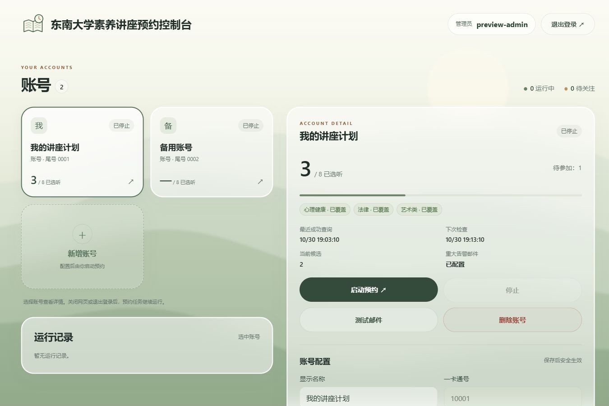

# 2026-10-30 管理员登录与单页控制台离线验收

本轮实现依据[两轮已确认需求](../console-redesign.md)、[ADR-0010](../adr/0010-configured-admin-login.md) 与 [ADR-0011](../adr/0011-local-reservation-display-snapshot.md)。旧 [HTTP 简化验收](2026-10-30-http-console.md) 的匿名访问结论仅描述当时版本，当前学校数据 API 要求管理员认证。

## 实现与检查

- `.env` 的 `SEU_WEB_ADMINS` 可直接保存多个用户名和密码，也兼容已有哈希；普通密码在启动时派生为内存哈希，不改写配置。空配置、空密码、非字符串、重复用户名或无效哈希拒绝启动；`--hash-password` 为可选工具，不读取学校配置。标准库 PBKDF2-HMAC-SHA256、600000 次迭代、随机盐，无新增依赖。
- 登录固定 12 小时、多浏览器并存、退出仅撤销当前会话；重启丢弃内存会话。登录尝试受来源及全局上限约束，学校 API 要求登录与写操作 CSRF，原 Origin / JSON / 请求大小限制保留。
- 管理界面为浅色自然静态背景、磨砂卡片、黑色主按钮，无左侧导航或宣传区。页面名称为“东南大学素养讲座预约控制台”，学校账号在界面简称“账号”。Python / Pillow 生成纯图案书页与时钟 Logo 和静态风景，全部资源本地提供。
- 四个账号操作按钮等宽、等高（54px），主操作为深色、辅助操作为描边、删除操作为红色；放大管理员名称、退出登录、账号名称和关键状态。手机顶部允许换行，修复管理页最小宽度及登录卡片的窄屏溢出。
- 卡片末尾始终有新增入口；桌面右侧、手机下方显示详情。手动保存、未保存修改的页面内确认框、自动刷新保留草稿与配置冲突提示均已用浏览器验证。
- 数据库向后兼容增加配置 `revision`；旧版本保存先拒绝，不停止当前工作进程。已纳管账号统一应用隐藏策略，旧单账号 CLI 配置能力保持。
- 当前预约仅保存活动 ID、标题、类别、地点 / 线上方式、举办起止时间、预约状态及快照时间；覆盖学校全部有效未结束预约，不按选听计划去重舍弃重叠或沙龙预约。待确认与占位单列，页面访问不增加学校查询，失败保留上次快照。

| 检查 | 结果 |
| --- | --- |
| `uv run --locked pytest` | 667 通过、3 跳过（含直接配置管理员密码的补充回归）；跳过为两项 Unix 信号及一项 Windows 文件句柄替换限制 |
| `uv run --locked mypy seu_reserve` | 12 个源文件通过 |
| `node --check seu_reserve/web_assets/app.js` | 通过 |
| `uv run --locked python scripts/render_brand.py` | 生成资源，尺寸与透明背景自检通过 |
| `uv build --wheel` + 解包检查 | 认证模块及 HTML / CSS / JS / 两个 PNG 全部存在，旧文字 favicon 不再打包 |
| 浏览器桌面及手机 | 既有登录、卡片顺序、选中详情、隐藏选项、未同步 / 陈旧预约、人工认证面板、退出、保存及旧表单冲突通过；本轮文案与尺寸调整后复查 1365 / 820 / 390 / 320px，四按钮尺寸一致，管理页和登录页无横向溢出，新增账号及退出登录通过 |

浏览器运行于独立临时数据根和随机本机端口，使用构造学校账号、构造快照和替代工作进程，不读取真实 `.env`，不连接正在运行的 8080 管理台，不访问学校或发信。最初的浏览器原生确认框触发工具阻塞，最终改用页面内 `<dialog>` 并重新验证取消切换保留输入。桌面与手机截图均为构造数据：

[手机管理台截图](../images/console-mobile.jpg) · [手机登录截图](../images/login-mobile.jpg)

## 尚未验证

未修改真实管理员配置或部署 / 重启现有服务；首次使用直接在 `.env` 填写管理员账号和密码后重启，哈希命令可选。真实学校多账号、SMTP 送达、Linux systemd、真实开抢收益及长期运行未验证，既有单账号样本不能代替上述验收。HTTP 与本地明文凭据的已确认取舍仍存在，仅限可信局域网 / VPN。

密码派生实现依据 [Python hashlib](https://docs.python.org/3.12/library/hashlib.html#key-derivation) 与 [OWASP 密码存储建议](https://cheatsheetseries.owasp.org/cheatsheets/Password_Storage_Cheat_Sheet.html)；HTTP Cookie 的约束见 [MDN Set-Cookie](https://developer.mozilla.org/en-US/docs/Web/HTTP/Reference/Headers/Set-Cookie)。
