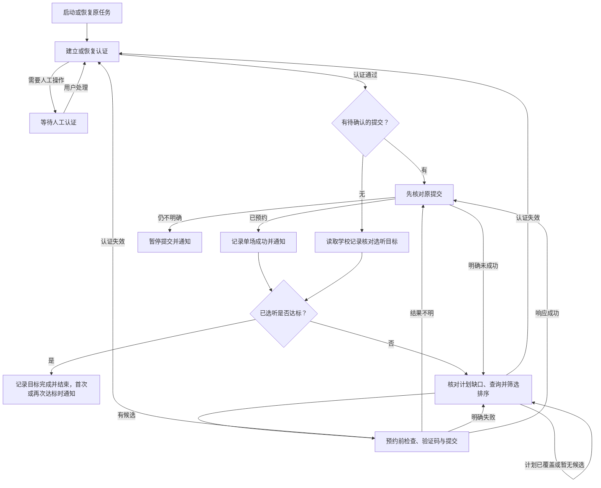

# 讲座预约需求澄清

日期：2026-10-15（Asia/Shanghai）。依据：交接资料及本次逐轮需求访谈。
Q1–Q19 已逐项确认，用户已确认完整需求并要求整理发布规格；本文记录目标行为，不代表相关能力已经实现或验证。
2026-10-15 后续确认邮件可选及 Gmail 两项配置，见 Q20；该补充优先于原规格中的必需邮件配置。
2026-10-16 用户明确服务器版定位和脚本入口，见 Q21；选听目标见 Q22，优先于 Q1、Q8、Q14 的原单场任务边界，并调整 Q10 的类别和 Q17 的排序。
2026-10-16 后续确认 Linux 服务器使用文档、网关 DNS 优先回退及启动署名，见 Q23。
2026-10-16 后续确认不区分年级、不支持 3 次目标，以及已有重叠记录的本地自动选择，见 Q24。
2026-10-16 后续确认使用截图的宣传展示和文档同步范围，见 Q25。
2026-10-18 用户要求修正真实讲座字段映射，停止当前进程、同步文档并提交推送，见 Q27。
2026-10-18 用户通过 grill-with-docs 澄清参考浏览器版的后续改造，两轮范围及细节已按推荐确认，见 Q28–Q33；整体规格已确认；实施与验证记录见[使用与验收](usage.md)。

领域术语见 [GLOSSARY.md](../GLOSSARY.md)。命令行实现与离线验证已落地，实际接入与长期验收进度见[使用与验收](usage.md)。

本文保留需求确认过程；初始实施规格已发布为 [GitHub Issue #1](https://github.com/MuZiJin701/seu-lecture-reserve-http/issues/1)，后续确认的邮件调整以本文 Q20 为准。

用户后续补充：登录信息、筛选、状态目录和邮件统一通过 `.env` 配置，提供 `.env.example`，主要字段沿用原项目命名；采用 HTTPS 技术方案，筛选与认证行为仍按本文已确认规则执行。进程环境变量优先，真实配置不纳入 Git。

## 交接基线（历史）

以下记录接手时的验证边界；本仓库后续完成的真实登录、只读查询及其他验收进度见[使用与验收](usage.md#验收记录)。

- 独立的 Python HTTPS 客户端，以活动 ID 识别讲座和确认预约结果。
- 提交结果不明确时先查询目标活动的预约状态，避免盲目重复提交或自动取消。
- 交接参考探针已验证认证、受保护查询、验证码获取、预约前检查及 90 秒内会话复用；本仓库当时尚未复现。
- 真实预约、OCR、短信验证流程、跨天会话恢复及长期运行尚待验证。

## 用户已确认

### Q1：成功后的停止条件（历史，已由 Q22 替代）

查询到目标活动 ID 的已预约记录后，认为本次预约成功并退出。即使有多个符合条件的讲座，也只预约成功一场。

### Q2：人工短信认证

要求短信验证时，进入待人工认证状态；认证未通过时不能开始或恢复业务轮询及预约提交。恢复入口见 Q6，状态关系见 Q12。

### Q3：轮询

初始每 10 秒查询一次列表；网络或服务异常时退避，学校明确限流时遵循限制。
这是初始产品选择，需实测调整，不代表已验证的安全请求频率或预约成功率。

### Q4：通知

预约成功、需要人工认证或持续失败时记录终端和本地事件；启用邮件时再主动通知。正常轮询时保持安静。只接一种主动通知渠道，选择见 Q7、Q20。

### Q5：筛选功能范围

首版保留完整标题匹配、类别、校区、线上线下开关及时间冲突检查。
首版不增加日期范围、每日可用时段或讲座时长筛选。默认值见 Q10，条件组合见 Q9，候选排序见 Q17。

### Q6：短信恢复入口

用户通过 SSH 进入服务器终端，输入短信验证码后恢复运行。
认证成功后才可恢复业务轮询。这是用户交互要求；纯 HTTPS 短信流程仍需调查和验证。

### Q7：通知渠道

邮件为唯一主动通知渠道，且为可选功能；未配置时仍允许预约，通过终端和本地日志查看事件。真实邮箱地址和认证配置通过安全配置提供，不写入需求文档。

### Q8：无候选时的等待（单场边界已由 Q22 替代）

列表为空或没有符合条件的讲座时持续等待，直到成功预约一场或用户主动停止，不设置固定运行截止时间。
认证受阻及持续异常单独处理，不视为正常等待。

### Q9：指定标题的约束

指定标题仍须满足类别、校区、线上线下开关和时间冲突条件。
标题列表非空时做完整标题匹配；空列表时不限制标题。同名讲座按不同活动 ID 分别处理。

### Q10：默认可约范围（沙龙已由 Q22 排除）

沿用旧项目的五类讲座，精确名称为：

- `人文与科学素养系列讲座_心理健康`
- `人文与科学素养系列讲座_法律`
- `人文与科学素养系列讲座-艺术类`
- `人文与科学素养系列讲座_其他`
- `“SEU咖啡间"系列沙龙活动`

默认允许线上；线下只允许明确配置的校区，未配置校区时不约线下。
用户目前未指定线下校区。

### Q11：时间冲突

检查“我的活动”中全部有效预约，首尾相接也视为冲突。
例如已有讲座 15:00 结束，则不约 15:00 开始的另一场。
候选时间无法解析时跳过该候选；已有预约查询不完整时暂停本轮提交，不能默认没有冲突。
首版只检查系统内预约，不接个人日历。

### Q12：认证与业务状态（按用户纠正）

需要短信验证代表认证尚未完成或已失效，此时进入待人工认证状态。
认证成功后才进入业务轮询；运行中认证失效时回到认证流程。
首次认证尚未成功时业务轮询本就没有开始，不能描述为“停止已有轮询”。
等待期限、短信重发及不支持的认证挑战处理见 Q18，自动恢复边界见 Q19。

### Q13：故障通知

连续三轮查询失败后记录故障事件，启用邮件时发送一次邮件；同一次故障不重复通知，恢复后重置计数。
邮件只含脱敏状态和处理提示。发送失败不能触发重复预约。
通知失败不改变已确认的预约结果，并在本地记录；后续继续或结束按 Q22 的选听目标处理。

### Q14：重启与提交结果不明（单场边界已由 Q22 替代）

程序重启后接着处理原预约任务；已经成功的任务不再预约。
存在结果不明的提交时先核对它，期间不提交其他讲座。
持续无法核实时暂停提交并通知用户；再次预约另一场需要用户明确启动新任务。

### Q15：单场失败与 OCR

验证码明确错误时，最多重新取图识别三次；仍失败则让该场冷却五分钟，尝试其他候选。
明确已满或不可预约时跳过。超时等结果不明的情况走 Q14，不能当作验证码错误重试。

### Q16：长期运行验收

先完成离线失败路径检查，再做至少 24 小时服务器观察，覆盖正常等待、网络恢复和进程重启。
真实预约、短信恢复、跨天会话分别验收；没有遇到对应场景时标记待验证，不以运行时长替代验证结果。

### Q17：候选优先级（必需类别优先见 Q22）

按配置中的类别顺序、线上优先、开始时间较早优先依次选择候选。
标题列表只限定范围，不表示优先顺序。第一候选明确失败后，按该顺序尝试后续候选。
提交结果不明时仍须遵守 Q14，不因候选排序而继续提交。

### Q18：等待人工认证

待人工认证状态不设置固定超时，等待用户处理或主动停止，不自动反复发送短信。
验证码过期后在用户回来处理时重新获取；暂不支持的认证挑战保持等待并说明原因。

### Q19：自动恢复认证

会话失效时先自动尝试恢复会话或重新登录；需要短信等人工操作时进入待人工认证状态。
明确提示凭据错误或账号受限时停止自动登录尝试并通知，避免反复重试。
认证通过后才可恢复业务轮询。

### Q20：可选邮件与简化配置（后续确认）

- 不配置邮件也能正常预约；成功、需要人工认证、持续失败及预约结果待确认等事件仍记录终端和本地日志。
- Gmail 只需完整邮箱地址 `SMTP_USERNAME` 和应用专用密码 `SMTP_PASSWORD`，自动使用 `smtp.gmail.com:465`，默认自己给自己发邮件。
- 保留旧的完整 SMTP 配置及无需认证的 TLS 中继；非空的显式服务器、端口、发件人和收件人配置优先，其他邮箱不自动识别。
- 邮件字段均为空或缺省时关闭邮件；仅保留默认 `SMTP_PORT=465` 不算启用。尝试配置但缺项、邮箱格式错误、无法确定 SMTP 主机或端口无效时，明确报错并停止启动。
- 发信失败仅记录，不改变预约结果、不触发重复预约；真实邮件送达仍须单独验收。

### Q21：服务器版定位（2026-10-16）

本项目主要面向服务器上的持续讲座预约，使用独立 HTTPS 客户端；对照的[浏览器项目](https://github.com/MuZiJin701/SEU_Lecture_Reserve)主要面向 Windows 主机配合浏览器运行。

预约目标后续调整见 Q22。用户已确认希望采用类似浏览器版的脚本启动命令，推荐入口改为 `uv run main.py`，支持 `uv run --locked main.py`，保留旧命令兼容。SSH 断开、进程退出及服务器重启后的运行边界已在后续 Q33 确认。

### Q22：中期考核讲座目标（2026-10-16）

- 用户给定目标：中期考核前至少选听 8 次系列讲座，其中法律、艺术、心理健康各至少 1 次。此处作为用户个人目标，不声明为所有培养方案的统一要求。
- 已确认：采用学校记录中已打卡、未违约且活动未取消的系列讲座作为已选听次数，不代替学院最终考核认定。进度直接从学校读取，不要求手工维护次数。
- 已确认：已选听与有效待参加预约共同占用缺口；覆盖 8 场及三类后暂停新增、继续核对，只有已选听本身达标才结束。取消或学校标记违约后补足；已结束但尚未登记打卡或违约时等待确认，避免重复补约。
- 已确认：成功一场后通知并继续；优先补齐缺少的必需类别，给尚缺类别预留名额，其余按 Q17 原顺序选择。已有记录导致必须超过 8 场才能满足类别时，仅补必要类别。标题、校区、线上线下和冲突规则继续适用，目标统计不因筛选排除历史记录。
- 已确认：先不增加考核截止日期配置，由用户控制时间。
- 已确认：“SEU咖啡间”沙龙不计入且不自动预约；四类系列讲座为心理健康、法律、艺术及其他。
- 按活动 ID 去重统计，未知状态/类别、矛盾重复或已提供总数不一致时暂停新增。真实接口样本及尚未证明的全历史完整性见[完成记录接口调查](completion-records.md)。
- 旧状态版本 1 的单场 `done` 自动迁移为版本 2 的扫描任务，保留待确认提交、冷却和退避；新版 `done` 仅表示整个目标达标。`--new-task` 保留为重新核对已完成目标的入口，不再用于额外预约一场。

### Q23：使用文档、网关 DNS 回退与启动署名（2026-10-16，已确认）

- 已确认：重写中文 `README.md` 和英文 `README.en.md`，以简单易懂的步骤说明配置、只读检查、启动、后台运行及恢复，详细排错和开发记录放在使用文档。
- 已确认：主要面向 Linux 服务器，同时保持 Windows 兼容；命令示例统一使用 `cp` 等现有命令，不单独介绍 Windows 命令。
- 已确认：网关连接先使用正常 DNS，失败后尝试 `SEU_VPN_IP` 配置的 IP，参考[浏览器实现](https://github.com/MuZiJin701/SEU_Lecture_Reserve/blob/89f9965955b12ce37016bb46db6a613aeef60780/browser.py#L57-L98)。此项替代原来的“配置即固定使用 IP”。
- 已确认：仅在首次登录阶段，遇到网关解析失败、连接关闭或重置、可识别的 TLS 意外断开时，回退并重新走认证流程一次；普通超时、证书校验失败、账号密码错误、代理错误、HTTP 错误及其他域名故障不触发。
- 已确认：`.env.example` 预填 `SEU_VPN_IP=121.249.14.2`，程序内部不写死默认 IP；缺省或留空关闭回退。回退后本次进程持续使用备用 IP，下次启动重新尝试 DNS。首次登录完成后不再新增自动切换。
- 继续保留 HTTPS 域名证书校验及提交结果不明时先查询的保护；不通过此机制自动重放预约提交。
- 已确认：启动署名使用 `MuZiJin701` 和本项目 GitHub 链接；正常启动预约和执行 `--check` 时各展示一次，后台运行时随终端输出写入重定向日志，轮询时不重复展示，`--status` 保持简洁。
- 本节记录已确认需求；实现与验证进度见[使用与验收](usage.md)，离线检查不代替真实 DNS 故障恢复验收。

### Q24：培养要求的适用范围与已有重叠记录（2026-10-16，已确认）

- 用户补充的学校要求：一般研究生在中期考核前至少选听 8 次系列讲座，21–26 级须法律、艺术、心理健康各至少 1 次；港澳台研究生和国际留学研究生至少 3 次，考核合格后计 1 学分。本条记录用户提供的文字，不代表已核验学校最新政策；3 次人群是否仍有必选类别要求不能擅自推定。
- 已确认：产品不按年级区分，不增加年级配置或年级自动识别；不支持港澳台研究生或国际留学研究生的 3 次目标，继续采用 Q22 的 8 场及三类各至少 1 场目标，不增加学生类别或目标次数配置。
- 用户补充：禁止同一时间段预约并参加多场讲座，多场中仅一场有效，其余作违约处理。最终有效场次、违约和学分仍以学校认定为准。
- 既有保护：新增预约会避开学校已有有效预约的重叠区间，首尾相接也视为冲突，提交后先核对再选择下一场。
- 变更前的缺口：不同活动 ID 的已有重叠记录未单独核对；学校尚未标记违约时，可能同时计入已选听次数或待参加计划。按活动 ID 去重及排除学校已标记的违约记录，不能覆盖这个场景。
- 已确认：已有重叠记录尚无明确学校处理结果时，不因重叠本身暂停；由程序自动选择一场并继续运行。
- 已确认：选择仅用于本地完成次数及待参加计划统计，不取消或修改学校已有预约，不自行将未选中的记录标记为违约。未打卡的场次不能计为已选听；新增预约仍与全部学校有效预约检查冲突，包括未计数的场次。
- 已确认：每次选择优先已打卡且未违约的场次，再优先补齐当前缺少的必选类别，然后选结束较早的场次，最后按活动 ID 固定选择；选择后更新类别缺口并排除与它冲突的统计候选，再选择下一场。
- 已确认：所选场次彼此不冲突，链式重叠不要求整组只留一场。例如 A 为 10:00–11:00、B 为 10:30–11:30、C 为 11:10–12:00，状态及类别相同可选 A 与 C，计两场；首尾相接仍视为冲突。按上述优先级逐次选择，不承诺全局最多场次。
- 全部记录仍须通过原有字段、状态、时间和重复 ID 一致性校验；若所选记录已结束但学校尚未确认打卡或违约，继续遵守 Q22 的等待规则。旧版已完成任务需要用 `--new-task` 按新口径重新核对，不自动重置任务。

### Q25：使用截图与文档同步（2026-10-16）

- 已确认：在中英文 README 简介后、快速开始前展示用户提供的 [Linux 终端截图](images/使用截图.png)，说明后台启动与本地任务状态查询。
- 已确认：`status=scanning` 仅为本地任务状态，不能据此宣称进程健康或预约成功；保留真实预约及长期运行仍待验收的边界。
- 已确认：检查全部文档并同步受影响内容，包括双语 README、使用指南中的截图说明与验收记录，以及本文的需求确认；没有术语或规则变化时保留术语表和 Agent 规则。

### Q26：运行健康、故障通知及邮件验收入口（2026-10-16）

- 用户授权本次集中补齐运行可观测性和邮件验证能力，停止当前预约进程并保留任务，完成验证后提交并推送；另已明确授权向当前配置的收件人发送一封真实测试邮件。交付时保持预约进程停止。
- `--status` 保留首行 `status=...`，增加运行阶段、最近成功查询和更新时间、距今秒数、连续失败及最近错误时间、下一次检查时间、列表与候选数量、任务通知状态。信息保存在私有任务状态文件，不保存凭据、票据、讲座标题或完整活动记录。
- 是否运行以现有任务锁为依据，不把遗留 PID 或 `scanning` 当作判活证据。正常轮询更新本地快照，终端不输出每轮心跳；首次启动和认证通过记录带时间戳的事件。旧任务或非法快照显示运行信息未知，不据此宣称健康。
- 最近成功查询指完成当前轮所需的学校查询及数据校验；计划覆盖后只核对“我的活动”也会更新。处理或提交阶段单独显示，成功查询时间不能替代真实预约成功证据。
- 保留连续三轮查询或处理失败提醒一次、恢复后清零的规则。补齐正常运行中可捕获的异常退出通知，明确凭据拒绝不重复发两封；同一进程内新的待确认提交可以再次提醒。邮件失败只记录，不自动重发或改变预约结果。
- 增加互斥入口 `--test-mail`，只发送一封固定内容的测试邮件，不需要学校凭据，不登录学校、不创建或重置预约任务。SMTP 接受与收件箱送达分别验收，未配置、无效配置或发送失败返回非零退出码，错误不泄露配置。
- 本次真实测试返回 `test_mail_accepted`，用户随后明确确认已收到邮件，测试邮件送达验收通过。
- `--check` 仍不提交预约、不发邮件、不修改任务。SIGTERM 走正常停止路径，保存最后运行阶段、释放锁；强制终止、断电及邮件服务不可达不能保证主动通知。运行信息写入失败显示固定错误，业务提交前的持久化保护不变。
- 真实预约、实际验证码准确率、短信端到端恢复、跨天及至少 24 小时运行仍依对应场景验收，不以本次只读检查或离线回归代替。

### Q27：真实讲座列表字段适配（2026-10-18）

- 用户明确授权：修正真实字段映射，停止当前预约进程，更新相关文档，验证后提交并推送；保留任务，交付时保持停止。
- 依据真实非空列表及学校前端核对候选字段：`JZMC`、`JZXL_DISPLAY`、`JZSJ` / `HDJSSJ`、`JZDD`、`FBZT`、`YYKSSJ` / `YYJSSJ`。不再要求学校提供构造响应中的 `HDMC`、`HDLX_DISPLAY`、`IS_ONLINE`、`YYZT`。
- 依据预约时间窗、发布状态及已有预约判断是否进入候选；时间按 Asia/Shanghai 解释，主机应准确校时。不猜测 `SFKSYY` 数字值的业务含义，名额和资格仍由学校预约前检查及提交确认决定。
- 线上线下仅识别当前样本标题开头明确的 `【线上】` / `【线下】` 标记，缺少标记或未知关键字段时报错，不能伪装成正常的零候选；保留旧显式字段格式的兼容。原类别、校区、标题、目标和冲突规则继续适用。
- `--check` 校验与正常轮询相同的候选字段，包括尚未开放的列表；仍不提交预约、不创建任务、不发邮件。空列表无法验证字段适配，非空解析成功不能替代真实预约验收。
- 以构造值复现真实响应的字段与类型，补充开放时间边界、提交确认、未知结构、筛选和只读路径的离线回归，不保存真实活动明细或个人记录。本次不启动真实预约、不新增真实邮件测试，不把此前运行时长算作修复后的长期验收。

### Q28：借鉴浏览器版的改造范围（2026-10-18，两轮条目已确认）

- 参考本地 `/root/projects/SEU_Lecture_Reserve`，其对应仓库为 [SEU_Lecture_Reserve](https://github.com/MuZiJin701/SEU_Lecture_Reserve)。对照基线为浏览器版 `fa60f63` 与本项目 `bf389e4`；参考项目的实现或验收记录不代表本项目已经实现或验收。
- 用户对首轮四项建议回复“按照推荐”：纳入中文进度邮件、每日汇报、故障恢复通知、跨重启告警去重、邮件错误分类及发送耗时记录；邮件继续可选。具体边界见 Q29、Q30。
- 纳入筛选诊断：只读检查能说明未开放、类别、校区、冲突等筛选原因；正常轮询保持安静。诊断粒度、输出与持久化范围见 Q31。
- 每次正常启动重新认证并读取学校记录核对进度，即使本地曾标记完成；学校记录变化导致目标不足时继续补足。保留待确认提交的保护，`--status` 仍仅查询本地状态。本条覆盖 Q14、Q22、Q24 中依赖本地完成标记直接退出、必须使用 `--new-task` 才重新核对的旧约定；兼容入口和重复完成通知细节见 Q32。
- 同步改进中文和英文 README 及使用指南：账号、筛选和邮件配置均放在首次运行之前，补齐 Gmail 应用专用密码、Ubuntu 安装及后台运行步骤。具体平台和运维边界见 Q33。
- 沿用独立 HTTPS 定位、固定八场及三类目标、冲突检查、结果不明先核对等已确认规则；浏览器依赖及浏览器版不提供短信交互的行为不随本轮范围确认迁入。
- 两轮访谈后用户已明确回复“确认”，授权按本节及 Q29–Q33 实施和离线验证；真实学校访问、预约、发信与部署不在本次实施范围。历史条目的提交、推送和真实操作授权不自动延续到本次改造。

### Q29：每日汇报与邮件内容（2026-10-18，第二轮已确认）

- 用户对第二轮五项建议回复“按照推荐”。每日汇报固定在北京时间（Asia/Shanghai）20:00，仅在预约程序运行且启用邮件时发送；当天 20:00 后启动，在首次安全等待时尝试当天汇报。
- 同一状态目录同一天最多尝试一次，发送前持久化尝试日期，重启不重复；不补更早日期，失败或发送结果不明均不自动重发。关闭邮件、只读检查、程序停止或目标完成退出后不继续汇报。
- 汇报包含最近核对的已选听数、待参加数、含待参加计划的必需类别缺口、数据时间、最近查询情况及待处理问题。数据过旧时标明时间，尚未取得时显示未知，不能把查询失败当作零场。重要事件邮件也采用中文说明、处理建议和相同的安全进度上下文；成功通知使用本轮核对结果。
- 等待或退避期间可为汇报唤醒，但不得提前开始学校查询或预约。认证输入、请求或提交处理中可推迟至安全等待点，不保证整点送达。
- 复用已有同步 SMTP 及 TLS 传输，记录发送事件、实际耗时和安全错误分类；保留最近一次邮件结果供重启后查看。测试邮件与运行通知使用相同错误分类，不打印异常原文、SMTP 响应、邮件地址或凭据。先依据耗时评估影响，不增加邮件线程、后台队列或自动补发。
- 邮件仅包含必要的汇总进度、时间及安全状态，不含讲座标题、学校凭据、验证码、会话票据或完整个人活动记录；SMTP 接受与收件箱送达继续分别判断。

### Q30：跨重启告警、恢复与告警间隔（2026-10-18，第二轮已确认）

- 同一尚未解决的认证受阻、预约结果待确认或连续查询／处理失败，只尝试邮件告警一次；发送前保存告警记录，重启不重复，发送失败或结果不明不自动重发。问题解决后清除对应记录；之后出现的新问题可重新告警。
- 连续三轮查询或处理失败触发故障告警；首次完整恢复当前模式所需的查询／处理后，尝试发送一次恢复通知，可接续重启前的故障告警。仅登录成功或部分读取不算恢复；待确认模式的查询恢复不代表预约成功。未触发故障告警的短暂失败不发恢复邮件。
- 两次查询／处理失败告警至少相隔十五分钟，间隔跨重启保留；同一持续故障仍只提醒一次。冷却期间出现的新故障若持续到期，在随后失败检查时告警。该间隔不延后学校查询或原有退避，不限制认证受阻及预约待确认告警。
- 关闭邮件时仍记录终端和本地事件，不消费新的持久邮件告警配额；发信不改变预约结果，也不得触发重复提交。正常轮询保持安静。

### Q31：逐场筛选诊断与私有快照（2026-10-18，第二轮已确认）

- `--check` 使用与正式扫描一致的学校数据校验和候选筛选规则，逐场展示讲座标题、首个命中的筛选原因、学校提供的预约开放及截止时间；时间以 Asia/Shanghai 展示，缺失时明确显示未知。通过筛选仅代表候选，不代表资格通过、存在名额或预约成功。
- 正常扫描在私有状态文件中保存最近一轮逐场诊断及快照时间，`--status` 离线展示；重启保留最近快照。只核对待参加记录、处理待确认结果或查询失败期间可能没有新列表，不把旧快照冒充当前结果，也不为了诊断额外增加学校查询。
- 本条明确覆盖 Q26 的“状态文件不保存讲座标题”限制，仅允许保存当前列表的必要筛选诊断；不保存完整个人活动记录、凭据或票据。活动详情不写入事件日志或邮件，含详情的终端输出和状态文件应留在本地。
- 原有字段校验、时间解析和异常保护继续适用；未知结构不能伪装成空列表或普通筛选排除。只读检查不读取本地任务冷却作为学校事实，也不创建、迁移或修改任务、不提交或取消预约、不发送邮件。

### Q32：已完成任务重新核对及兼容入口（2026-10-18，第二轮已确认）

- 正常启动始终要求正常认证并读取学校记录，即使本地任务已是 `done`；缺少凭据时沿用终端输入或非交互报错规则，不能沿用本地已完成任务免凭据直接退出的旧行为。
- 已完成任务重新核对仍达标时直接结束，不重复发送目标完成邮件；学校记录变化后不再达标则恢复扫描，再次实际达标时通知。原本未完成的任务首次达标仍通知并结束。
- `--new-task` 保留为已完成任务重新核对的兼容入口，不用于多约一场，也不允许重置扫描中或待确认任务。不能通过普通启动或该参数清除待确认、冷却和退避保护；状态损坏或账号不符时继续报错，不能默认覆盖。
- `--status` 仍离线，不要求学校登录，也不把本地完成标记宣称为最新学校结果。保留现有账号绑定及任务锁，使用时同一账号只运行一个预约实例，不增加跨项目状态共享或跨主机协调。

### Q33：文档与服务器运行边界（2026-10-18，第二轮已确认）

- 中英文 README 按安装、填写全部配置、只读检查及可选测试邮件、前台或后台启动、查看状态与日志、停止和恢复的顺序编排；首次运行前给出 Gmail 应用专用密码的获取与填写步骤。
- Linux 安装和后台运行以 Ubuntu 24.04 LTS 为主要示例，保留 Windows 兼容说明；采用本项目现有 Python 3.12、uv、锁文件及 HTTPS 入口，不引入浏览器安装步骤或照搬浏览器专用配置。
- 后台沿用 `nohup`、输入输出重定向、日志和 PID 文件；展示先建目录再启动、核对进程与最近查询、核对命令和工作目录后停止、保留状态并重新启动的完整步骤。SSH 断开后继续运行，进程退出或服务器重启后由用户手动启动。
- 保留现有前台短信及待确认结果处理方式；后台没有交互终端时保留任务并退出，确认退出后在前台处理。不新增守护服务、远程输入通道、自动重启或通知渠道。
- 同步受影响的使用指南、命令帮助与配置样例；保留已验收与待验证的区分，不提前把尚未实现的能力写成可用功能。本轮未产生新的领域定义或需要单独 ADR 的架构取舍。

### Q28–Q33 的实施与验收清单（整体已确认）

- 在现有 `seu_reserve.app.run` 边界补齐通知、汇报、诊断及启动行为，配套调整邮件、命令行、私有状态读写及调用方；复用本项目已有实现和依赖，不依赖参考仓库在运行时存在。
- 离线回归覆盖北京时间 20:00 边界、跨日及晚启动、重启去重、退避期间发信不提前查询、邮件关闭／失败、旧数据与未知进度、安全内容、邮件分类及耗时保留。
- 覆盖持续故障、短暂失败、完整／部分恢复、跨重启告警与十五分钟间隔，以及恢复通知不等于预约成功、邮件失败不能重复预约。
- 覆盖逐场首个筛选原因、开放时间、候选与排除、未知结构、快照时效和重启保留；只读检查无任务或邮件副作用，事件日志及邮件无讲座详情。
- 覆盖本地已完成后重新认证、仍达标不重复通知、记录变化后恢复扫描、再次达标通知、缺少凭据、兼容参数、账号不符和旧状态兼容；保持待确认提交、任务锁、冷却和退避的回归保护。
- 文档检查覆盖双语说明一致性、本地链接、配置先于运行和后台命令的文件前置条件；实现完成后按项目约定运行类型检查及完整离线测试。真实预约、OCR 准确率、短信恢复、邮件送达、跨天及至少二十四小时运行分别验收，未执行的场景仍待验证。
- 整体确认后仅实施本次改造并完成离线验证及文档同步；不借用历史授权开展真实学校访问、发信、部署、提交或推送。交付检查并暂存本次修改，保留已有无关修改及暂存状态。

### Q34：字段适配复核与其他逻辑缺陷（2026-10-18）

- 用户在实施期间要求核查活动字段与真实响应不匹配的旧问题，并检查、修复其他逻辑缺陷。本轮以 Q27 已核实的字段结构和构造响应离线回归复核，不重新读取真实个人记录或访问学校；当前响应是否变化仍需单独只读验收。
- 真实格式继续使用 `JZMC`、`JZXL_DISPLAY`、`JZSJ` / `HDJSSJ`、`JZDD`、`FBZT`、预约时间窗和明确的授课方式标记，不退回要求旧构造字段或猜测 `SFKSYY`。尚未开放时也须校验字段，合法非空响应不能被静默跳过为零候选。
- 预约前检查仅在明确成功时继续；明确已满／不可预约等已识别失败可跳过，未知结构、错误类型或未识别失败须报错退避，不能伪装成正常无候选。
- OCR 输出限定非空 ASCII 字母数字及原有长度上限，其他识别结果走原有有界重取图与冷却，不发送明显无效的 Unicode 验证码。
- 候选按活动 ID 去重；完全一致的重复只处理一次，矛盾重复暂停本轮提交，避免重复候选绕过四次 OCR 尝试及五分钟冷却限制。保留原活动 ID 结果确认与待确认提交保护。

## 状态关系

下图包含 Q28、Q32 已确认的启动核对及通知规则；实现与验证记录见[使用与验收](usage.md)。

图中为业务主流程；正常查询间隔、失败退避及单场冷却分别遵循 Q3、Q13、Q15，新增邮件与恢复通知规则以 Q29、Q30 为准。
图中的“通知”始终保留本地事件记录，仅在启用邮件时主动发信。
任何非终止状态都可由用户主动停止；停止不会自动取消已有预约。

## 实施与验收边界

- 完整需求及应用入口的主要测试边界已由用户确认；初次规格发布不包含应用实现、安装依赖或部署。后续 Q20 已确认实现与离线回归检查，不包含真实发信或部署。
- 首先复现已验证的认证和只读流程，再验证 OCR、预约提交及恢复流程。
- 真实预约、短信认证、跨天恢复等测试依赖对应场景；未遇到时保留待验证状态。
- 邮件收发配置、学校凭据及真实业务记录通过安全环境提供，不作为需求文档附件。
