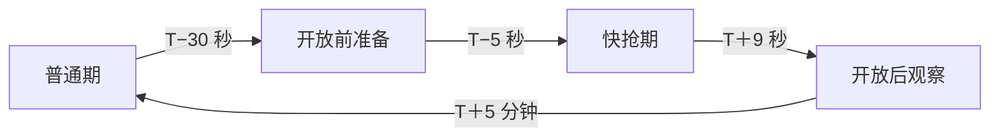
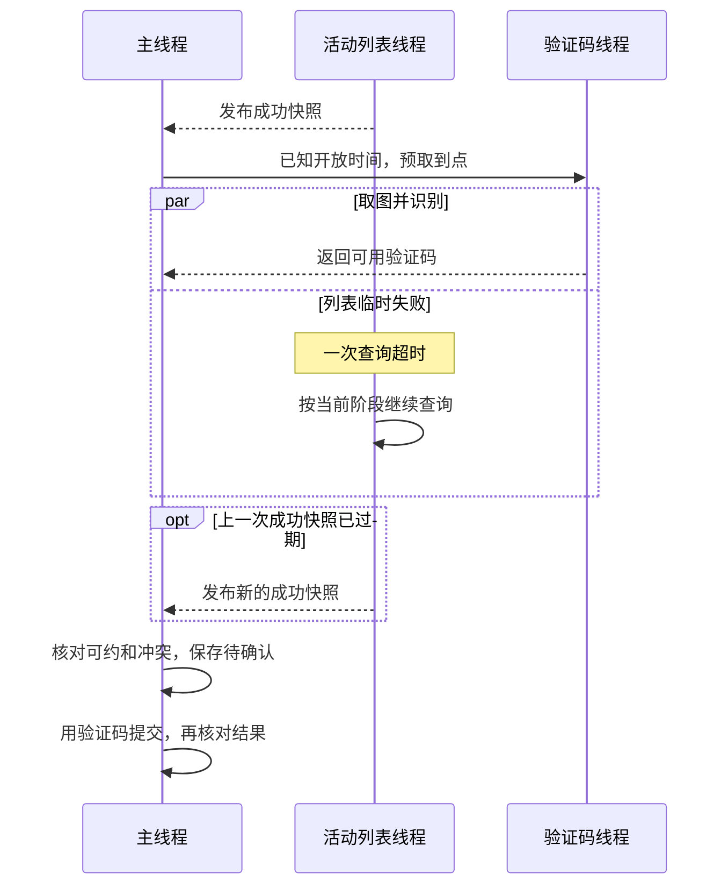

# 预约查询策略

[使用指南](usage.md) · [业务规则](requirements.md) · [真实验证状态](acceptance/2026-11-05-prep-history-goal.md)

**T 是学校公布的预约开放时间。** 程序以运行机器的时钟为准，切换查询阶段、触发我的活动预热和验证码预取、判断预约时间窗，以及计算时间占位的期限。学校提供开放时间、截止时间、发布状态和名额。请用 NTP 等方式保持运行机器的系统时钟同步。

## 各阶段查什么

| 线程 | 普通期 | 开放前准备 | 快抢期 | 开放后观察 |
| --- | --- | --- | --- | --- |
| **活动列表** | 每 4–6 秒 | 每 0.5–1.5 秒 | 每 0.05–0.10 秒 | 每 0.5–1.5 秒 |
| **我的活动列表** | 登录、待确认或确认成功时查 | 同普通期 | 进入快抢期时另行预热一次 | 同普通期 |
| **验证码** | 有候选才现场取图 | 有候选才现场取图 | 目标 T−2.7 秒预取，有候选时优先用准备好的码 | 需要时现场取图 |
| **主线程** | 认证、筛选、提交、核对 | 同普通期，跟随列表加快 | 候选可约且验证码就绪后尽快提交 | 继续处理剩余候选和待确认结果 |
| **邮件** | 按配置后台发送 | 同普通期 | 同普通期 | 同普通期 |

- **活动列表**的查询间隔在表中范围内随机，包含请求耗时。同一列表线程一次只发一笔请求。普通期单次预算和成功快照有效期均为 10 秒，其余三个阶段均为 2 秒。快照从成功返回时起计时。遇到更早的预约截止时间，或没有剩余目标且没有待确认结果，可提前降频。多个窗口重叠时采用较快节奏。
- **我的活动列表**每次查询预算 8 秒。可靠结果用于排除时间冲突，取得首次结果后可继续使用最近一次成功结果。后续刷新失败会按当前阶段节奏重试，主线程可以继续筛选和准备。学校侧手动增删预约后，可停止再启动账号来同步。
- **主线程**负责调度我的活动预热、验证码任务和串行提交。列表和我的活动线程各自查询并重试。普通期每笔认证请求和提交各用 10 秒预算。开抢三个阶段分别为 6 秒和 8 秒。校验通过后先保存待确认记录，再向学校提交。

## 验证码何时准备、能用多久

以 **19:00 开放**为例，运行机器时钟到 **18:59:55** 进入快抢期。开启我的活动预热时，此时会通知我的活动线程，主线程同时用一次普通活动列表读取，在验证码预取和提交共用的会话上建立可复用连接；这次读取失败只记录本地诊断，不改变预取排程。验证码预取目标是 **18:59:57.300**。已登录、已有可靠结果和已知开放时间、没有待确认提交时，即使列表正在等待或临时失败，也可以到点取图。错过目标时，距开放仍超过 0.45 秒才启动预取。同一开放时刻最多尝试两次。

验证码线程负责**取图和识别**，列表和我的活动线程各自处理查询超时并重试。主线程用有效的列表快照和最近一次可靠结果筛选候选，并在提交前复核。列表线程重试时，只要上一份成功快照仍有效，主线程就可以继续。列表快照过期或首次可靠结果尚未取得时，主线程等相应快照再提交。

预取单次预算 **8 秒**，识别结果从收到图片起最多复用 **8 秒**。现场取图和本地有效期普通期为 **10 秒**，开抢三个阶段为 **8 秒**。这些期限用于本地调度，学校的验证码实际有效期尚未测定。同一账号只运行一个验证码任务。验证码线程与主线程共用会话和连接池，取图时独占会话。慢预取可能跨过开放时间，主线程会等会话归还后再提交。

## 失败后怎么继续

| 遇到的情况 | 下一步 |
| --- | --- |
| 列表或我的活动临时断网、超时、响应格式错误 | 各自按当前阶段的节奏再查，我的活动继续重试同一次刷新。主线程继续使用仍有效的列表快照和最近一次可靠结果。 |
| 取图临时失败、OCR 异常、识别无效或学校明确判错 | 主线程在当前轮安排验证码线程再次取图。每个候选一轮最多四次，含取图失败和预取码被判错。用完本轮次数后继续处理其他候选或开始下一轮。 |
| HTTP 429 或有效 `Retry-After` | 本账号暂停发出新请求。429 没给有效等待时间时至少等一秒。已发出的请求继续完成。 |
| HTTP 502–504，未给有效等待时间 | 列表或我的活动线程在本线程短退避，连续失败时分别等待 1、2、4、5 秒，最多 5 秒；直接同步适配器下由主线程短退避。取图按本轮额度换码重试。认证或提交按自身规则处理。 |
| 登录过期 | 重新认证，旧会话的验证码随之失效。 |

临时错误只由遇到错误的线程按既定节奏重试。其他线程继续各自的查询、取图或发信，活动也不会进入冷却。主线程缺少提交或确认所需的证据时，等待相应结果。

## 提交后怎样确认

程序按活动 ID 核对学校列表和“我的活动”。两路各自查询，任一路取得可靠的已预约记录即可确认。学校回复成功后也要核实。结果仍不明确时暂停其他提交。如果连续三次有效的双来源核对均未找到该活动，程序先保留时间占位，再恢复扫描。每次有效核对至少间隔两秒，失败或结果矛盾会重新计数。详见[待确认和时间占位](requirements.md#状态与恢复)。

## 学校接口与数据校验

列表从 `queryActivityList.do` 读取活动与预约时间窗，按活动 ID 合并预约人数 `hdrsList.YYRS` 与容量 `HDZRS`。“我的活动”来自 `queryMyActivityList.do`，按 `HD_WID` 核对。程序校验响应结构及学校给出的总数。目标统计不要求打卡 `SFDK`，违约 `SFWY='1'` 不计入目标，撤回 `FBZT='-1'` 不能确认预约。排查见[状态与日志](usage.md#状态与日志)。
