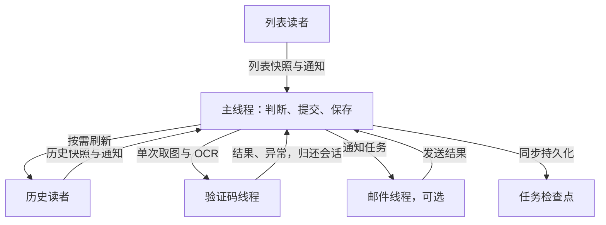
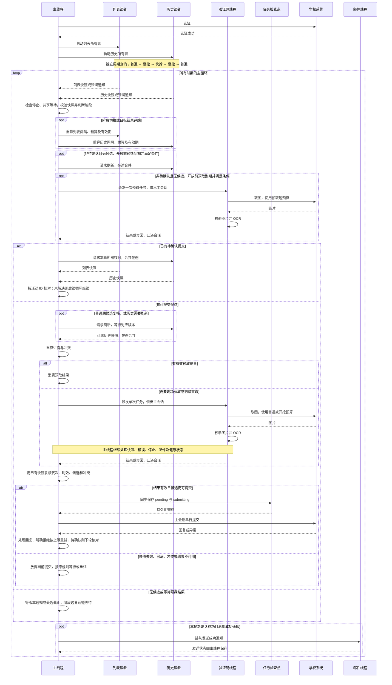

# 线程协作与预约查询策略

[使用指南](usage.md#开抢与拥塞恢复) · [Web 指南](web.md) · [需求](requirements.md#认证轮询与提交) · [README](../README.md)

**源码核对：2026-11-04，统一验证码线程、开抢快照 2s；尚未部署。** 下文按单个学校账号说明，多账号各有工作进程，请求量相加。查询时期与业务状态独立：普通、慢抢、快抢期都可能取验证码、提交或进入待确认。

## 线程分工

| 执行者 | 职责 | 学校会话 |
| --- | --- | --- |
| 主线程 `app.run` | 认证、校验快照、筛选、派发验证码、决定重试、串行提交与核对；唯一保存任务状态 | 主业务会话 |
| `activities-reader` | 查询 `queryActivityList.do`，发布列表快照，自行重试 | 独立列表会话 |
| `history-reader` | 查询 `queryMyActivityList.do`，定期/按需刷新，合并在途请求，自行重试 | 独立历史会话 |
| `captcha-worker` | 统一执行预取、现场及判错重取的取图/OCR；首次需要时启动，空闲等待 | 独占借用主业务会话 |
| `mail-sender` | 顺序发送通知，结果回主线程保存；不改变预约结果 | 不访问学校 |

认证后有主线程和两个只读线程，邮件与验证码线程按需增加，共 **3–5 个业务线程、3 个学校 HTTP 会话**，不含 DNS、OCR 库内部线程。验证码执行期间，主线程不能使用或复制主会话，两个已有读者继续运行。日志加锁追加；任务检查点始终由主线程同步保存。

## 各时期参数

`T` 为学校开放时间，`E` 为预约截止时间。区间左闭右开，开抢窗口截于 `min(E,T+300s)`；多场重叠取更快策略。

| 参数 | 普通期 | 慢抢期 | 快抢期 |
| --- | --- | --- | --- |
| 范围 | 开抢窗口之外 | `[T-30s,T-5s)`、`[T+9s,T+300s)`，截于 `E` | `[T-5s,T+9s)`，截于 `E` |
| 列表目标请求开始间隔 | 随机 4–6s | 随机 0.5–1.5s | 随机 0.05–0.10s |
| 列表/历史读取预算 | 10s | 2s | 2s |
| 列表快照有效期 | 10s | 2s | 2s |
| 历史定期刷新间隔 | 25s | 5s | 5s |
| 历史快照有效期 | 30s | 10s | 10s |
| 现场验证码/提交预算 | 各 10s | 各 8s | 各 8s |

各时期线程职责不变，主要改变查询节奏与准备时机：普通期缓存筛出候选后，必须请历史读者重新核对；慢抢和快抢期可用仍可靠的历史。邮件按原触发条件发送，不因开抢延后。

- **间隔**控制目标节奏：读者单个在途，扣除请求耗时；重试、按需刷新和对齐会改变实际间隔。
- **预算**约束在途请求：阶段变化不终止已发请求，保留其开始时预算；不保证绝对完成时限。
- **有效期**从成功响应完成计算：在途查询不延长旧快照年龄，新成功结果立即替换。开抢期允许使用两秒内的上次成功结果；超时等明确失败会标记错误，即使未满两秒也不能用于新增预约。

主线程有可靠快照时，普通期轮末计划等 4–6s，开抢期按相应目标减处理耗时；新快照、验证码和邮件结果可提前唤醒。缺快照时等通知或最近截止项，最多五秒重查，不同步查询兜底。阶段变化重算读者等待，不重建健康读者、不额外查询。

全部待抢目标结束且没有待确认提交时可提前降频；已预约、撤下或被筛选排除的目标可结束追踪。满额仍可能释放名额，缺行、空列表和异常数据也不能直接证明目标结束。

## 开放前准备

准备使用偏保守的本地开放估算 `T_est`，与阶段表中的学校时间 `T` 不同；计算方法见[使用指南](usage.md#开抢提速实验项)。

| 动作 | 触发条件 | 执行与限制 |
| --- | --- | --- |
| 历史预热 | 约 `T_est-2s`，剩余时间大于 0.4s | 历史读者按需刷新；同场成功派发最多一次，在途合并，不保证开放前完成 |
| 验证码预取 | 约 `T_est-0.6s`，剩余时间大于 0.45s | 验证码线程执行；同场最多一次；预算最多 0.6s，并预留约 0.03s；估算开放后不预取 |
| 列表对齐 | 开启对齐选项，目标为下一场 `T_est` | 列表读者只调整一次等待；目标须在未来且不超过两倍当前间隔，不新增查询 |

已校时且余量超过 2s 时，跳过上述准备，仍可现场取图。预取失败、过期或判错后回退现场任务，使用同一验证码线程。任务编号递增并标记认证代次；最多一个在途任务或未消费结果，新取图使旧缓存失效。结果从图片收到时计龄，超过五秒、超预算或认证失效即丢弃。

管理台账号统一开启后台历史、预热、预取和对齐；旧 CLI 保留开关。关闭预取仍由验证码线程现场获取；`SEU_HISTORY_BACKGROUND=false` 仅关闭定期刷新，启动和按需查询仍由历史读者完成，普通/开抢缓存为 30s/60s。

## 全时期预约时序

普通、慢抢、快抢共用下列主循环；阶段改变读者参数，预热和预取只在开放前满足条件时派发。图中通知仅在结果变化时发生，主线程不要求每轮两路都更新；读快照不代表额外请求，两个读者独立运行。停止与服务端等待优先，条件不满足时不执行后续业务箭头。

提交前复核只用已有可靠快照；已满、冲突或快照失效则放弃当前提交，不增加复核请求。单轮每候选最多四次验证码/提交尝试，判错或非法识别达到上限后冷却；网络故障走外层退避，“四次”不是整个任务的网络重试总上限。现场取图仍是提交前置步骤，移到线程不会消除其耗时。

## 待确认与故障处理

待确认期间暂停其他提交和新的开抢准备，两个读者继续运行。

| 情况 | 处理规则 |
| --- | --- |
| 提交持久化后产生可靠正向预约证据 | 按活动 ID 确认，可提前结束两秒等待 |
| 两路完整可靠、请求起点均不早于本次核对起点，且均未确认预约 | 有效缺席计数加一；下一次缺席检查至少两秒后 |
| 请求尚在途 / 来源失败或数据矛盾 | 在途只等待；失败或矛盾中止核对并重置连续缺席计数 |
| 连续三次有效缺席且占位信息完整 | 先保留原活动时间占位，再解除全局待确认；后续重试仍受占位和次数限制 |
| 429 / 有效 Retry-After | 学校请求共用最长等待截止，验证码实际取图前也检查；通知不能缩短等待，已在途请求不强制中断 |
| 可恢复查询失败 | 原读者自行重试，不联动关闭健康读者；开抢白名单瞬时错误约 0.1s，其他通常 1、2、4、5s 退避 |
| 主线程可恢复错误 | 开抢白名单瞬时错误通常约 0.25s；其他短退避，502–504 通常为 1、2、4、5s；服务端等待优先 |
| 认证失效 | 丢弃旧验证码/历史；归还借出会话后重新认证，旧读者释放在途端点后再恢复 |
| 停止 | 等待循环约 0.2s 检查一次停止，停止新派发；收尾等在途验证码归还，邮件队列最多等五秒 |

Condition＋版本号通知结果变化：先确认版本再消费，等待时持锁核对，避免丢唤醒；它不是按来源排序的优先级队列。服务端退避期间可处理停止、邮件和健康状态，不能提前请求学校。观察状态约一秒合并保存，关键阶段和任务状态仍同步持久化，保留五分钟故障告警门槛。

## 维护与验证

| 改动范围 | 实现 | 回归测试 |
| --- | --- | --- |
| 阶段、参数、主循环、待确认 | [app.py](../seu_reserve/app.py)：`read_policy`、`scan_delay`、`run` | [test_unified_workers.py](../tests/test_unified_workers.py)、[test_app.py](../tests/test_app.py) |
| 查询、合并、对齐与恢复 | [poller.py](../seu_reserve/poller.py)：`ActivityPoller` | [test_poller.py](../tests/test_poller.py)、[test_opening_recovery.py](../tests/test_opening_recovery.py) |
| 通知等待、验证码和会话交接 | [runtime.py](../seu_reserve/runtime.py)：`WorkSignal`、`CaptchaWorker`；[app.py](../seu_reserve/app.py) | [test_scheduler_and_preparation.py](../tests/test_scheduler_and_preparation.py)、[test_captcha_worker.py](../tests/test_captcha_worker.py)、[test_runtime.py](../tests/test_runtime.py) |
| 邮件队列与退出 | [mail.py](../seu_reserve/mail.py)：`MailWorker` | [test_mail_worker.py](../tests/test_mail_worker.py) |

调度变更时同步更新本页图表、[使用指南](usage.md#开抢与拥塞恢复)和相关决策：[查询所有者](adr/0012-query-owners-and-mail-worker.md)、[版本等待](adr/0013-versioned-waits-and-captcha-preparation.md)、[统一验证码线程](adr/0014-single-captcha-worker.md)。`--check`、`--resolve-pending` 和直接查询离线适配器不代表上述生产线程链路；管理台每两秒读本地状态，不增加学校请求。

快照调整验证见[开抢快照 2s 验收](acceptance/2026-11-04-opening-snapshot-2s.md)；此前证据见[验证码线程验收](acceptance/2026-11-04-captcha-worker.md)和 [P0/P1/P2 验收](acceptance/2026-11-04-event-preparation.md)。当前版本真实开抢、提交、验证码准确率和长期运行仍待验收。OCR、Python 线程及本地调用不能硬中断，同步认证、提交和保存也可能阻塞；0.2s 停止检查粒度不是退出时限，五秒验证码年龄是本地限制，线程改造不保证命中率。
